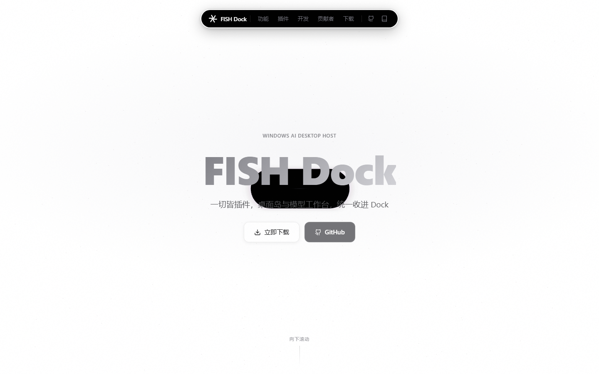

# FISH Dock 官网展示页

[FISH Dock](https://github.com/Fish-under-sea/FISH-Dock) 的官网展示页，是一个可离线运行的静态站点。页面基于 [pyisland.com](https://pyisland.com/) 官网模板改造：保留原站的滚动叙事结构、3D 灵动岛与全部视觉样式，内容替换为 FISH Dock 项目（Windows AI 桌面宿主，一切皆插件）。



## 页面结构

滚动叙事共七个章节，由滚轮驱动切换：

| 章节 | 内容 |
|---|---|
| Hero | 品牌标题、标语「一切皆插件，桌面岛与模型工作台，统一收进 Dock」与两个入口按钮 |
| 核心功能 | 桌面岛、模型工作台、插件中心、外观工具链、工作区、安装更新 |
| 官方插件 | 飞书通知、Clash 代理、Magpie 网关、OFM 本地模型（含版本号与状态） |
| 快速开始 | 完整安装、开发构建、插件安装、数据与备份四个场景的命令 |
| 贡献者 | FISH、Chensy、梧桐星痕、Jassdingk、咕咕咕（来自两个仓库的贡献记录） |
| 下载 | FISH Dock v1.2.3 与四个官方插件 v2.0.0；宿主提供直链与镜像下载 |
| 页脚 | 版权与备案占位 |

## 本地运行

需要 Node.js 18+，无需安装依赖：

```powershell
node serve.mjs
```

浏览器打开 <http://127.0.0.1:8080/>。端口被占用时换一个：`node serve.mjs 8081`。

`serve.mjs` 是零依赖静态服务器，提供正确的 MIME 类型（`.js`、`.css`、`.svg`、字体等）、路径穿越防护与 `no-store` 缓存策略。

## 部署

站点是纯静态文件，仓库根目录即可作为站点根：

- **GitHub Pages**：仓库 Settings → Pages → 选择 `main` 分支根目录发布即可。
- **任意静态托管**：把根目录文件原样上传（Nginx、Vercel、Cloudflare Pages 等均可）。
- 资源引用为绝对路径（`/_next/...`、`/avatar/...`），站点必须部署在域名根路径，而非子目录。

## 目录结构

```text
FISH-DOCK-Web/
├── index.html                    首页（Next.js SSR 输出，文案已替换）
├── serve.mjs                     零依赖本地静态服务器
├── _next/static/
│   ├── css/                      2 个样式表
│   └── chunks/                   Next.js 运行时与页面 chunk
├── avatar/                       贡献者头像（原站 6 张 + 5 位贡献者）
├── screenshots/                  页面截图（README 使用）
├── fonts/fonts.css               本地字体占位样式表
├── island_w.svg                  站点图标
├── favicon.ico
├── gabatb.png                    页脚备案图标
└── tools/                        抓取、改造与验证脚本
    ├── mirror.mjs                原始站点抓取
    ├── retheme.mjs               主体文案与数据对象替换
    ├── retheme2.mjs              贡献者、头像映射、邮箱链接
    ├── retheme3.mjs              OFM 状态与下载 fallback
    ├── retheme4.mjs              下载版本、具体资产链接、直链/镜像双按钮
    ├── shot2.mjs                 CDP 滚动截图
    └── verify-links.mjs          下载按钮跳转地址验证
```

## 内容与数据

- **版本**：宿主 FISH Dock `v1.2.3`；官方插件 `v2.0.0`（来自官方插件仓 Release）。
- **下载链接**：直达具体资产（`FISH-Dock-Setup-1.2.3.exe`、`feishu/clash/magpie/ofm.fish-plugin`）；宿主镜像使用 ghproxy 通用加速前缀，可替换为自有镜像。
- **版本查询 API**：原模板会请求旧站点版本列表并覆盖卡片链接，现已指向不可达地址，页面直接使用卡片内的资产链接。
- **贡献者**：资料依据 GitHub 贡献记录与插件分工整理，头像已本地化到 `avatar/`。

## 更新方式

站点是构建产物，不能直接重新构建（无原始 Next.js 工程）。内容更新通过 `tools/` 脚本对产物做文本替换：

1. 重新抓取原站：`node tools/mirror.mjs`（会覆盖 `index.html` 与 `_next`）。
2. 依次运行 `retheme.mjs` → `retheme2.mjs` → `retheme3.mjs` → `retheme4.mjs` 应用 FISH Dock 内容。
3. 修改 `retheme4.mjs` 顶部的 `DOCK_TAG` / `PLUG_TAG` 可更新下载版本。
4. 用 `tools/shot2.mjs`（需 Chrome 远程调试端口）滚动截图检查效果。

脚本会把改动前文件备份到 `tools/backup/`（未入库），需要回滚时覆盖回原路径。

## 技术栈

- 页面：Next.js App Router 静态导出产物（React 19、Three.js 3D 灵动岛、Tailwind 与 CSS Modules）。
- 本地服务：Node.js 原生 `http` 模块，零依赖。
- 字体：原站使用 Google Fonts（Inter / JetBrains Mono），镜像以空样式表替代，回退到 `Inter → Segoe UI → system-ui` 栈。

## 版权与致谢

- 页面模板、布局、样式与原始素材来自 [Pyisland 官网](https://pyisland.com/)，版权归 Pyisland 团队所有。
- FISH Dock 文案、插件信息、贡献者资料与链接归 [Fish-under-sea](https://github.com/Fish-under-sea) 项目所有。
- 本仓库仅用于 FISH Dock 项目的展示与学习，不用于商业用途。